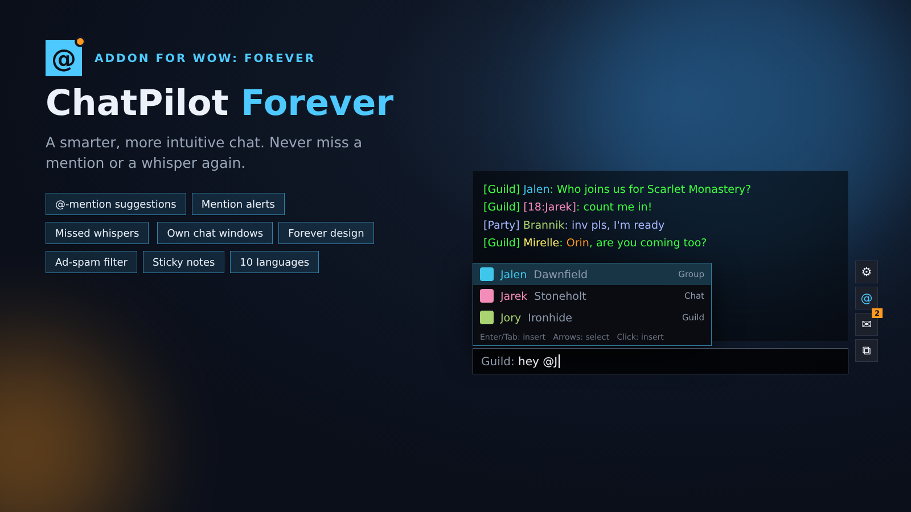
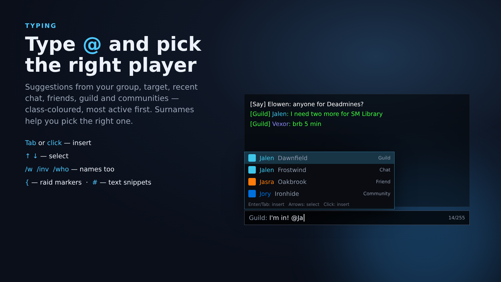
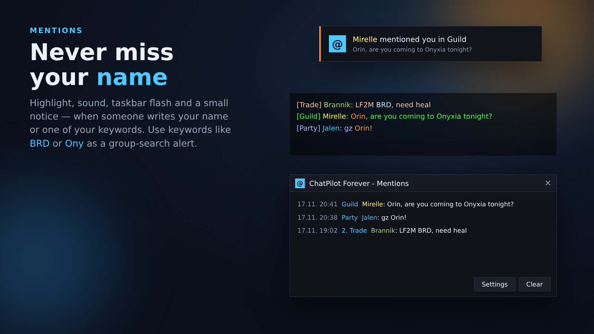
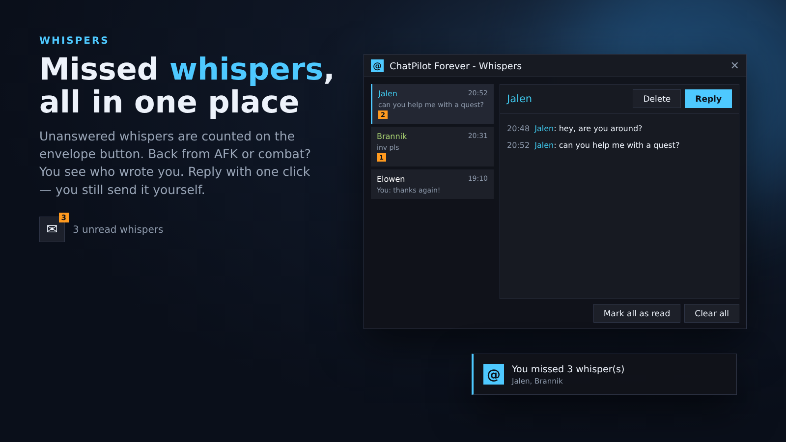
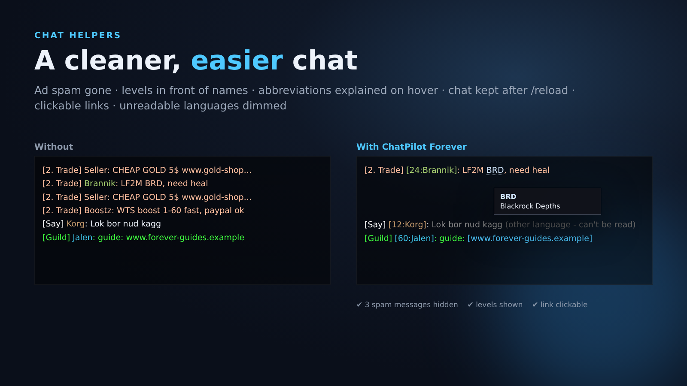
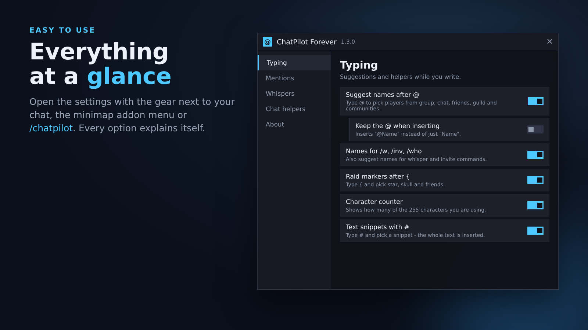
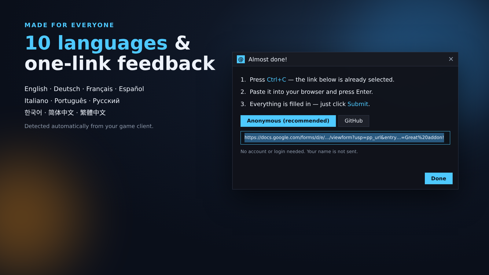
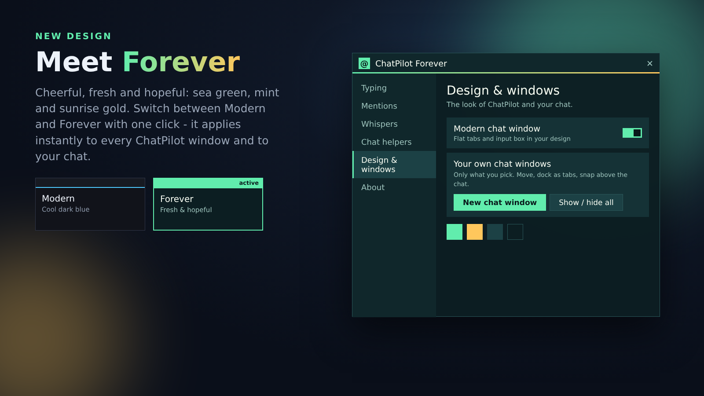
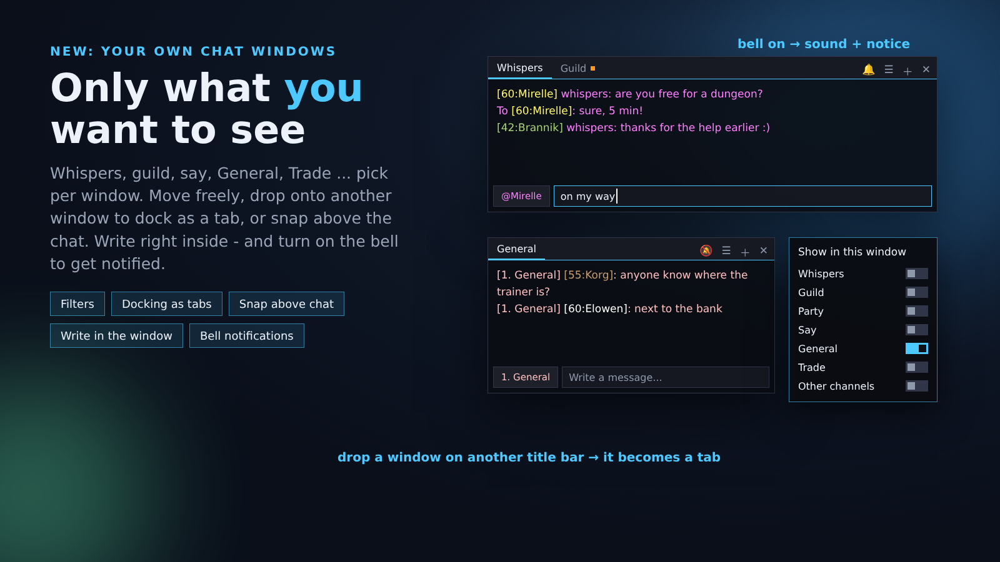
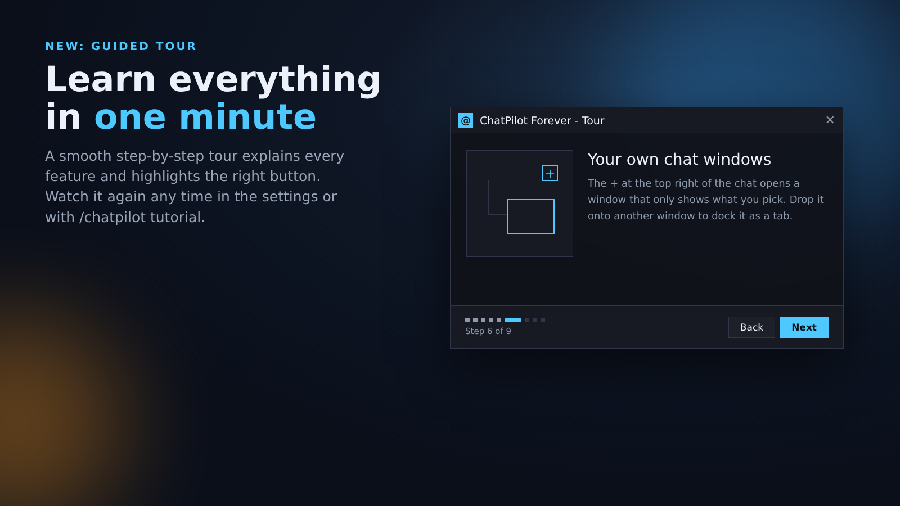

# ChatPilot Forever

**ChatPilot Forever – nie wieder etwas im Chat von WoW: Forever verpassen.** Schreib `@` und wähle den richtigen Spieler, werde benachrichtigt, wenn dich jemand erwähnt, und verpasse keine Flüsternachricht mehr. Dazu: kurze Nachnamen („Frost W.“), Spam-Filter, eigene Chat-Fenster und das Forever-Design.

**[🇬🇧 English version below](#english)** · **[CurseForge](https://www.curseforge.com/wow/addons/chatpilot)**

| | |
|---|---|
|  |  |
|  |  |
|  |  |
|  |  |
|  | |

## 🌍 Sprachen
ChatPilot passt sich automatisch der Sprache deines WoW-Clients an:
English · Deutsch · Français · Español (ES/MX) · Italiano · Português (BR) · Русский · 한국어 · 简体中文 · 繁體中文

## 💬 Feedback, Fehler & Ideen
**Ohne Anmeldung, anonym:** 👉 **[Feedback-Formular](https://forms.gle/zpQr4CFqMkBETFVV6)**

Mit GitHub-Konto – bitte über die Vorlagen:
- 🐞 **[Fehler melden](https://github.com/xXUltrOnionXx/ChatPilot/issues/new?template=bug_report.yml)**
- 💡 **[Idee vorschlagen](https://github.com/xXUltrOnionXx/ChatPilot/issues/new?template=feature_request.yml)**
- ⭐ **[Feedback / Lob](https://github.com/xXUltrOnionXx/ChatPilot/issues/new?template=feedback.yml)**

Im Spiel geht's am einfachsten: `/chatpilot feedback` → Nachricht schreiben → **Senden**. Du bekommst **einen fertig ausgefüllten Link**: Strg+C, im Browser einfügen, auf Absenden klicken – fertig.

## Funktionen

### Schreiben
- **@-Erwähnungen:** Tippe `@` und ChatPilot schlägt Namen vor – Leute aus deiner Gruppe, deinem Ziel, wer gerade im Chat geschrieben hat, Freunde, Gildenmitglieder und Mitglieder deiner Communities. Die Namen sind in Klassenfarben.
  - Wer gerade schreibt, steht weiter oben. `@` allein zeigt die aktivsten Leute.
  - **Enter**, **Tab** oder **Klick** fügt den markierten Namen ein (es wird noch nichts gesendet), **Pfeil hoch/runter** wählt aus.
- **/w, /inv, /who:** Auch hier gibt es Namensvorschläge (bei anderen Realms mit Realm-Namen).
- **Zielmarkierungen:** `{` + Name, z. B. `{ste` → Stern. Funktioniert in jeder Sprache (`{rt1}`–`{rt8}`).
- **Textbausteine:** In den Einstellungen Texte speichern, im Chat `#Kürzel` + Tab – fertig.
- **Zeichenzähler:** zeigt `123/255` im Eingabefeld, orange kurz vor dem Limit, rot wenn es voll ist.
- Funktioniert auch im **Community-Fenster**.

### Erwähnungen
- Erkennt, wenn jemand deinen Namen oder eins deiner **Stichwörter** schreibt (z. B. Spitznamen).
- Hebt den Namen im Chat **orange** hervor, spielt einen Ton ab, lässt das Taskleisten-Symbol blinken und zeigt eine kleine Benachrichtigung.
- **Erwähnungs-Verlauf:** `/chatpilot mentions` zeigt die letzten 100 Erwähnungen (auch die, die du verpasst hast).
- Namen in Item- und Quest-Links lösen keinen Alarm aus.
- **Tipp:** Eigene Stichwörter funktionieren auch als Suchalarm, z. B. `BRD` oder `Ony` – dann wirst du benachrichtigt, sobald jemand eine Gruppe dafür sucht.

### Verpasste Flüsternachrichten
- Unbeantwortete Flüsternachrichten werden am **Brief-Knopf** neben dem Chat gezählt.
- Ein Fenster zeigt alle Gespräche; **Antworten** öffnet dein Eingabefeld mit dem richtigen Namen (abschicken tust du selbst).
- Kommst du aus dem **AFK** oder einem **Kampf** zurück, siehst du, wer dir geschrieben hat.
- **Schriftgröße** und **normal/fett** für die Nachrichten sind einstellbar.
- Während Bosskämpfen kann das Spiel den Text verbergen – dann zählt ChatPilot die Nachricht nur und verweist auf den Chat.

### Chat verstehen
- **Stufe im Chat:** `[18:Arthas]` – farbig nach Schwierigkeit, auch bei Freunden und Gildenmitgliedern, die gerade online kommen.
- **Kurze Nachnamen:** „Frost Winterborn“ wird zu „Frost W.“ – gibt es zwei Frosts mit W, wächst das Kürzel automatisch („Frost Wi.“ / „Frost Wo.“). Maus über den Namen zeigt den vollen Namen; Flüstern und Klicks nutzen weiter den vollen Namen.
- **Abkürzungen erklärt:** Begriffe wie `LFG`, `WTS`, `pst`, `LF2M`, `gz` und Dungeon-Kürzel wie `SM`, `BRD`, `UBRS`, `MC` sind leicht hellblau. Fährst du mit der Maus darüber, erscheint die Erklärung. Mehrdeutige Kürzel (`AH`, `SM`, `ST` …) zählen nur in GROSSBUCHSTABEN, damit normale Wörter nicht markiert werden.
- **Fremde Sprachen:** Nachrichten in einer Sprache, die dein Charakter nicht kann (z. B. Gemeinsprache, wenn du Horde spielst), werden grau mit dem Hinweis „(fremde Sprache – nicht lesbar)“ angezeigt oder auf Wunsch ganz ausgeblendet. **Übersetzt werden sie nicht** – das ist technisch unmöglich (der Server schickt nur das Kauderwelsch) und von Blizzard nicht erlaubt.
- **Werbe-Spam weg:** Goldverkäufer, bezahlte Boosts und Webseiten-Werbung werden ausgeblendet. Normaler Handel, Freunde, Gilde und Gruppe bleiben unberührt. Das Zahnrad am Chat zeigt, wie viele Spam-Nachrichten heute ausgeblendet wurden.
- **Wiederholungen weg:** Wer in öffentlichen Kanälen (Handel, Suche nach Gruppe …) innerhalb von 90 Sekunden dasselbe noch mal schreibt, wird nur einmal angezeigt.

### Noch mehr Komfort
- **Chatverlauf bleibt:** Nach `/reload` oder erneutem Einloggen ist dein Chat noch da.
- **Anklickbare Links:** Internetadressen im Chat werden blau. Ein Klick öffnet ein Fenster, aus dem du den Link mit Strg+C kopierst.
- **Chat kopieren** mit **Suche** – über den Knopf neben dem Chat.
- **Update-Hinweis:** Hat jemand aus Gilde oder Gruppe eine neuere Version, sagt ChatPilot einmal Bescheid.
- **Notizzettel:** Kleine Zettel, die du frei verschieben, in der Größe ändern und minimieren kannst. Linksklick auf den gelben Zettel-Knopf zeigt oder versteckt alle Notizen, Rechtsklick legt eine neue an. **+** im Zettel = neuer Zettel, **–** oder Doppelklick auf den Titel = minimieren, **×** = löschen (bei Text mit zweitem Klick). Die Notizen bleiben gespeichert, für alle deine Charaktere.
- **Moderne Einstellungen** mit aufklappbaren Untermenüs.

### Design & Fenster
- **Zwei Designs:** „Modern“ (kühles Dunkelblau) oder **„Forever“** – fröhlich, frisch und hoffnungsvoll mit Meergrün, Minze und Sonnenaufgang-Gold. Gilt für alle ChatPilot-Fenster und wirkt sofort.
- **Modernes Chatfenster:** Der normale Chat bekommt einen flachen Look mit klaren Tabs und Eingabefeld im gewählten Design. Abschaltbar. Nutzt du schon ein Addon, das den Chat gestaltet (z. B. Prat, ElvUI, Chat Forever, PrimeChat, GudaChat), lässt ChatPilot den Look automatisch in Ruhe.
- **Eigene Chat-Fenster:** Fenster, die nur zeigen, was du auswählst – Flüstern, Gilde, Gruppe, Schlachtzug, Sagen, Schreien, Emotes, Allgemein, Handel, andere Kanäle, Communities oder Systemnachrichten.
  - Filter über das Trichter-Symbol im Fenster.
  - **Frei verschieben** an der Titelleiste, Größe unten rechts ändern.
  - **Andocken:** ein Fenster auf die Titelleiste eines anderen ziehen – es wird ein Tab. Tab wieder herausziehen zum Abdocken.
  - **Einrasten:** direkt über dem Chat ablegen – das Fenster sitzt dann über dem Chat und wandert mit.
  - **Neues Fenster mit einem Klick:** das **+** oben rechts am Chat (oder **+** im Fenster für einen neuen Tab).
  - **Direkt im Fenster schreiben:** Jedes Fenster hat ein Eingabefeld. Der Knopf links daneben zeigt, wohin die Nachricht geht – standardmäßig dorthin, woher die letzte Nachricht kam. Klick auf einen Namen = ihm flüstern. @-Vorschläge funktionieren auch hier.
  - **Glocke:** pro Fenster an-/ausschaltbar – Ton und Hinweis bei neuen Nachrichten.
  - Namen, Items und Links sind anklickbar, die letzten Nachrichten bleiben gespeichert.

### Rundgang
- Ein moderner Schritt-für-Schritt-Rundgang erklärt alle Funktionen und hebt den passenden Knopf hervor. Er erscheint einmal nach dem Update und lässt sich jederzeit wieder ansehen: Einstellungen → „Rundgang ansehen“ oder `/chatpilot tutorial`.

## Bedienung
- **Zahnrad** direkt rechts neben dem Chatfenster → Einstellungen (Knöpfe wahlweise auch über dem Chat)
- **@** daneben → Erwähnungs-Verlauf (orange Zahl = ungelesene Erwähnungen)
- **Brief** → verpasste Flüsternachrichten
- **Gelber Zettel** → Notizen (Rechtsklick: neue Notiz)
- **Notiz-Symbol** → Chat kopieren
- Oder über das **Addon-Menü an der Minimap**, `/chatpilot` bzw. Spieloptionen → AddOns → ChatPilot Forever

## Befehle
| Befehl | Wirkung |
|---|---|
| `/chatpilot` oder `/cpilot` | Einstellungen öffnen |
| `/chatpilot mentions` | Erwähnungs-Verlauf |
| `/chatpilot whispers` | Verpasste Flüsternachrichten |
| `/chatpilot notes` | Notizen zeigen/verstecken |
| `/chatpilot window` | Neues Chat-Fenster |
| `/chatpilot tutorial` | Rundgang ansehen |
| `/chatpilot design forever` / `modern` | Design wechseln |
| `/chatpilot copy` | Aktuellen Chat kopieren |
| `/chatpilot feedback` | Feedback geben |
| `/chatpilot add <Wort>` / `del <Wort>` / `list` | Stichwörter verwalten |
| `/chatpilot test` | Test-Alarm |

## Blizzard-Regeln (UI Add-On Development Policy)
ChatPilot wurde so gebaut, dass es die Regeln einhält:
- **Sendet nie von selbst.** Abgeschickt wird nur, was du selbst tippst und mit Enter bestätigst (im normalen Chat oder im Eingabefeld eines ChatPilot-Fensters). Keine Automatisierung, kein Spam, keine Server-Last. In gesperrten Momenten (z. B. Bosskampf) und bei /Befehlen übergibt ChatPilot den Text an das normale Eingabefeld des Spiels.
- **Kostenlos**, Quellcode offen und lesbar (nicht verschleiert), MIT-Lizenz.
- **Keine Werbung, keine Spendenaufrufe, keine Pop-ups im Spiel.** Das Feedback-Fenster öffnet sich nur, wenn du es selbst aufrufst.
- **Kein Internetzugriff, keine Datensammlung:** Das Addon kann keine Webseiten öffnen und nichts verschicken. Feedback geht nur raus, wenn du den Link selbst im Browser öffnest.
- Respektiert die Midnight-Addon-Einschränkungen: „geheime“ Chatwerte (Secret Values) werden nicht ausgelesen – ChatPilot macht in solchen Momenten einfach nichts.
- Nutzt nur `HookScript`/`hooksecurefunc` und Chat-Filter, ersetzt keine Blizzard-Funktionen, die Fehler („Aktion blockiert“) verursachen könnten.

---

## 🇬🇧 English

**ChatPilot Forever – never miss anything in WoW: Forever chat.** Type `@` and pick the right player, get notified when someone mentions you, and never miss a whisper again. Plus: short surnames ("Frost W."), spam filter, your own chat windows and the Forever design.

**[Download on CurseForge](https://www.curseforge.com/wow/addons/chatpilot)**

### 🌍 Languages
ChatPilot automatically follows your WoW client's language:
English · Deutsch · Français · Español (ES/MX) · Italiano · Português (BR) · Русский · 한국어 · 简体中文 · 繁體中文

### 💬 Feedback, bugs & ideas
**Anonymous, no account needed:** 👉 **[Feedback form](https://forms.gle/zpQr4CFqMkBETFVV6)**

With a GitHub account – please use the templates:
- 🐞 **[Report a bug](https://github.com/xXUltrOnionXx/ChatPilot/issues/new?template=bug_report.yml)**
- 💡 **[Suggest an idea](https://github.com/xXUltrOnionXx/ChatPilot/issues/new?template=feature_request.yml)**
- ⭐ **[Feedback / praise](https://github.com/xXUltrOnionXx/ChatPilot/issues/new?template=feedback.yml)**

Easiest way in game: `/chatpilot feedback` → write your message → **Send**. You get **one pre-filled link**: Ctrl+C, paste it into your browser, click submit – done.

### Features

#### Typing
- **@-mentions:** type `@` and ChatPilot suggests names – people in your group, your target, whoever just wrote in chat, friends, guild members and members of your communities. Names are class-coloured.
  - Recent chatters are ranked higher. A bare `@` shows the most active people.
  - **Enter**, **Tab** or **click** inserts the marked name (nothing is sent yet), **arrow up/down** selects.
- **/w, /inv, /who:** name suggestions here too (with realm name for other realms).
- **Raid markers:** `{` + name, e.g. `{sta` → star. Works in every language (`{rt1}`–`{rt8}`).
- **Snippets:** save texts in the settings, then type `#shortcut` + Tab in chat – done.
- **Character counter:** shows `123/255` in the edit box, orange near the limit, red when full.
- Also works in the **Communities window**.

#### Mentions
- Detects when someone writes your name or one of your **keywords** (e.g. nicknames).
- Highlights the name in **orange**, plays a sound, flashes the taskbar icon and shows a small notification.
- **Mention history:** `/chatpilot mentions` shows the last 100 mentions (including the ones you missed).
- Names inside item and quest links don't trigger an alert.
- **Tip:** keywords also work as a search alert, e.g. `BRD` or `Ony` – you get notified as soon as someone is looking for a group.

#### Missed whispers
- Unanswered whispers are counted on the **envelope button** next to the chat.
- A window lists all conversations; **Reply** opens your edit box with the right name (you send it yourself).
- When you come back from **AFK** or **combat**, you see who wrote to you.
- **Font size** and **normal/bold** text are adjustable.
- During boss fights the game may hide the text – ChatPilot then only counts the message and points you to the chat.

#### Understanding chat
- **Levels in chat:** `[18:Arthas]` – coloured by difficulty, also for friends and guild members who just came online.
- **Short surnames:** "Frost Winterborn" becomes "Frost W." – if two Frosts share the W, the tag grows automatically ("Frost Wi." / "Frost Wo."). Hover a name for the full name; whispers and clicks still use the full name.
- **Abbreviations explained:** terms like `LFG`, `WTS`, `pst`, `LF2M`, `gz` and dungeon shortcuts like `SM`, `BRD`, `UBRS`, `MC` are tinted light blue. Hover them to see the explanation. Ambiguous ones (`AH`, `SM`, `ST` …) only count in CAPITALS, so normal words aren't marked.
- **Foreign languages:** messages in a language your character can't speak (e.g. Orcish when you play Alliance) are greyed out with a "(foreign language – not readable)" note, or hidden entirely if you like. **They are not translated** – that's technically impossible (the server only sends scrambled text) and not allowed by Blizzard.
- **Ad spam gone:** gold sellers, paid boosts and website ads are hidden. Normal trading, friends, guild and group are never touched. The gear next to the chat shows how many spam messages were hidden today.
- **Repeats gone:** if someone posts the same thing again within 90 seconds in a public channel (Trade, LookingForGroup …), it's shown only once.

#### More comfort
- **Chat history stays:** after `/reload` or logging back in, your chat is still there.
- **Clickable links:** web addresses in chat turn blue. Clicking opens a box where you copy the link with Ctrl+C.
- **Copy chat** with **search** – via the button next to the chat.
- **Update notice:** if someone in your guild or group has a newer version, ChatPilot tells you once.
- **Sticky notes:** small notes you can move, resize and minimize. Left-click the yellow note button to show or hide all notes, right-click for a new one. **+** in a note = new note, **–** or double-click the title = minimize, **×** = delete (a second click if it has text). Notes are saved for all your characters.
- **Modern settings window** with collapsible sub-menus.

#### Design & windows
- **Two designs:** "Modern" (cool dark blue) or **"Forever"** – cheerful, fresh and hopeful with sea green, mint and sunrise gold. Applies to all ChatPilot windows, instantly.
- **Modern chat window:** the game's own chat gets a flat look with clean tabs and input box in your design. Can be turned off. If another addon already styles your chat (e.g. Prat, ElvUI, Chat Forever, PrimeChat, GudaChat), ChatPilot leaves the look alone automatically.
- **Your own chat windows:** windows that only show what you pick – whispers, guild, party, raid, say, yell, emotes, General, Trade, other channels, communities or system messages.
  - Filter via the funnel icon in the window.
  - **Move freely** by the title bar, resize at the bottom right corner.
  - **Dock:** drop a window onto another window's title bar – it becomes a tab. Drag the tab out again to undock.
  - **Snap:** drop it right above the chat – it then sits on top of the chat and moves with it.
  - **New window in one click:** the **+** at the top right of the chat (or **+** in a window for a new tab).
  - **Write right in the window:** every window has its own input box. The button on its left shows where your message goes – by default back to where the last message came from. Click a name to whisper that person. @ suggestions work here too.
  - **Bell:** turn it on per window – sound and notice for new messages.
  - Names, items and links are clickable, recent messages are saved.

#### Guided tour
- A modern step-by-step tour explains every feature and highlights the matching button. It shows up once after the update and can be watched again any time: settings → "Watch the tour" or `/chatpilot tutorial`.

### How to use
- **Gear** right next to the chat window → settings (buttons can also sit above the chat)
- **@** next to it → mention history (orange number = unread mentions)
- **Envelope** → missed whispers
- **Yellow note** → sticky notes (right-click: new note)
- **Note icon** → copy chat
- Or via the **addon menu at the minimap**, `/chatpilot`, or Game Menu → Options → AddOns → ChatPilot Forever

### Commands
| Command | Effect |
|---|---|
| `/chatpilot` or `/cpilot` | Open settings |
| `/chatpilot mentions` | Mention history |
| `/chatpilot whispers` | Missed whispers |
| `/chatpilot notes` | Show/hide notes |
| `/chatpilot window` | New chat window |
| `/chatpilot tutorial` | Watch the tour |
| `/chatpilot design forever` / `modern` | Switch design |
| `/chatpilot copy` | Copy current chat |
| `/chatpilot feedback` | Give feedback |
| `/chatpilot add <word>` / `del <word>` / `list` | Manage keywords |
| `/chatpilot test` | Test alert |

### Blizzard rules (UI Add-On Development Policy)
ChatPilot is built to follow the rules:
- **Never sends on its own.** Only what you type yourself and confirm with Enter is sent (in the normal chat or in a ChatPilot window's input box). No automation, no spam, no server load. In restricted moments (e.g. boss fights) and for /commands, ChatPilot hands the text to the game's own input box.
- **Free**, open and readable source code (not obfuscated), MIT license.
- **No ads, no donation requests, no in-game pop-ups.** The feedback window only opens when you call it yourself.
- **No internet access, no data collection:** the addon can't open websites or send anything. Feedback only leaves your PC if you open the link in your browser yourself.
- Respects the Midnight addon restrictions: "secret" chat values are never read – ChatPilot simply does nothing in those moments.
- Uses only `HookScript`/`hooksecurefunc` and chat filters and doesn't replace Blizzard functions that could cause "action blocked" errors.
